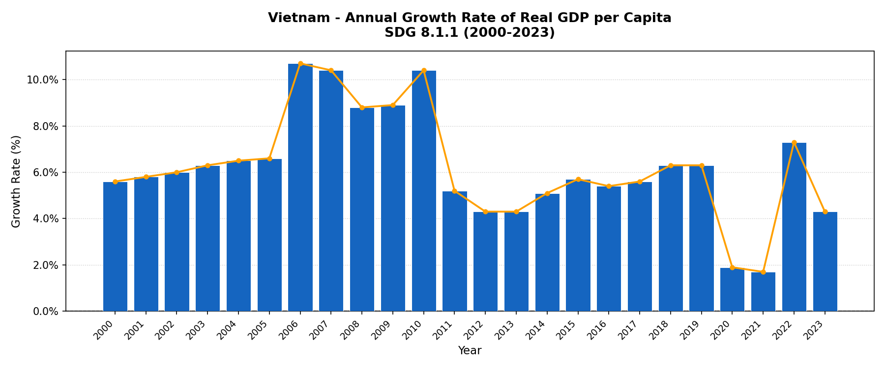

# Vietnam SDG Indicators Dashboard

A Python and Streamlit project exploring education, employment, economic growth, and income inequality in Viet Nam through six United Nations Sustainable Development Goal (SDG) indicators.

Developed as an individual data analytics project during my internship with the **International Sibling Society (ISS)**, the dashboard brings together **558 source observations**, **eight visualizations**, and **four thematic tabs** to support discussion of development trends and data limitations.



## Internship context

The International Sibling Society is a nonprofit promoting awareness of the UN Sustainable Development Goals through media, arts, partnerships, podcasts, and the Global Race for Sustainability. Within the data analytics internship, I studied Vietnam's progress across three connected goals:

- **SDG 4 — Quality Education:** participation in education and training, and teacher qualifications.
- **SDG 8 — Decent Work and Economic Growth:** real GDP per-capita growth, unemployment, and youth disengagement from education and work.
- **SDG 10 — Reduced Inequalities:** the share of people living below 50% of median income.

The project asks how economic progress relates to education, labor-market participation, and inclusion. My work included retrieving official UN observations, assessing reporting gaps and comparability, exploring the data in Python and Tableau, and presenting findings and limitations during recurring reviews with interns, mentors, and supervisors.

The broader internship also included Google Analytics work on nonprofit website engagement and recommendations for content and navigation. This repository contains the SDG analysis and dashboard; the website analytics reports and Tableau workbooks are not included.

## Dashboard features

| Tab | Visualizations |
| --- | --- |
| Economic Growth | Annual growth rate of real GDP per capita |
| Inclusive Growth | GDP growth alongside the population share below 50% of median income |
| Labor Market | Unemployment by sex for ages 15+; youth NEET rates by sex for ages 15–24 |
| Education | Teacher qualifications over time by education level; latest available teacher qualifications by sex and level; education participation by age; education participation by sex for ages 15–64 |

The application uses cached Excel loading, reusable pandas transformations, and Matplotlib charts displayed in Streamlit. Expandable raw-data tables let readers inspect the observations behind the charts. Several charts shade 2020–2021 as a reference period.

The interface provides tab navigation and data tables; the Matplotlib plots are rendered figures rather than hover-enabled charts.

## Data and coverage

All six workbooks contain UN SDG global monitoring extracts for Vietnam data. Coverage spans 2000–2024 across the collection, with different reporting years and demographic breakdowns for each indicator.

| Workbook | SDG indicator | Series code | Measure | Records | Year range |
| --- | --- | --- | --- | ---: | --- |
| `gdp.xlsx` | 8.1.1 | `NY_GDP_PCAP` | Annual growth rate of real GDP per capita (%) | 24 | 2000–2023 |
| `unempl.xlsx` | 8.5.2 | `SL_TLF_UEM` | Unemployment by sex and age, 13th ICLS (%) | 165 | 2000–2023 |
| `neet.xlsx` | 8.6.1 | `SL_TLF_NEET` | Youth not in education, employment, or training, 13th ICLS (%) | 48 | 2007–2023 |
| `propb50.xlsx` | 10.2.1 | `SI_POV_50MI` | Population living below 50% of median income (%) | 11 | 2002–2022 |
| `propteach.xlsx` | 4.c.1 | `SE_TRA_GRDL` | Teachers with minimum required qualifications (%) | 163 | 2000–2024 |
| `partrateedu.xlsx` | 4.3.1 | `SE_ADT_EDUCTRN` | Participation in formal and non-formal education and training (%) | 147 | 2007–2023 |
| **Total** | | | | **558** | |

Each workbook includes `Table format`, `Record format`, and `CodeDescriptions` sheets. The code reads `Record format`, using `TimePeriod` and `Value` plus dimensions such as `Sex`, `Age`, and `Education level` where applicable. The record count includes demographic observations; it does not mean 558 distinct years or people surveyed.

The internship workflow used the UN Statistics Division SDG data source and API. The checked-in application reads local Excel snapshots: it does not fetch live data or include an API extraction script. No API key or account is needed to run it.

See [xlsx_file_summary.txt](xlsx_file_summary.txt) for a more detailed workbook inventory.

## Selected observations

These descriptive findings come from the bundled snapshots:

- **GDP growth slowed during 2020–2021 and rebounded in 2022.** Real GDP per-capita growth was 6.3% in 2019, 1.9% in 2020, 1.7% in 2021, 7.3% in 2022, and 4.3% in 2023. Growth remained positive in those years.
- **Female youth NEET rates exceeded male rates in every reported year.** The average female–male gap across paired reporting years was about **3.86 percentage points**.
- **Teacher qualification gaps differed by education level.** In 2024, 91.09% of female pre-primary teachers and 70.59% of male pre-primary teachers held the minimum required qualifications, a gap of about **20.5 percentage points**.

These patterns motivate further questions about inclusion and access. They do not establish the causes of the differences.

## Interpretation and limitations

- **Reporting is uneven.** The year ranges above do not imply complete annual coverage for every demographic group. No source rows have missing `Value` entries in the bundled files, but absent years and subgroup combinations still limit comparisons. The analysis does not impute missing observations; lines between points are visual connections.
- **Latest available years vary.** The teacher comparison selects the latest observation for each education-level/sex group. Pre-primary, primary, and lower-secondary observations extend to 2024; secondary and upper-secondary snapshots use 2022.
- **Some chart behavior needs care.** The teacher comparison substitutes a zero-height bar if a level/sex group has no record. Such a bar should not be interpreted as an observed 0% qualification rate.
- **Measures have specific meanings.** Below 50% of median income is a relative-income measure, distinct from an absolute poverty threshold. GDP growth and income-distribution series also have different reporting frequencies and use separate axes in the comparison chart.
- **This is descriptive analysis.** Coincident changes, including those during the shaded COVID period, do not establish causation. The project does not fit a predictive model or estimate policy effects.
- **Some dashboard narrative needs revision.** Existing commentary includes statements that conflict with the snapshots, including a GDP contraction, a decline in NEET rates to roughly 6% by 2019, and persistently higher female unemployment. The verified figures above and workbook records should guide interpretation; explanations attributing changes to COVID or other mechanisms require additional evidence.

## Repository guide

```text
ISS_SDG/
├── README.md                 # Project context, setup, data, and limitations
├── dashboard.py              # Four-tab Streamlit dashboard and eight chart functions
├── plot_gdp.py               # Standalone GDP chart generator
├── requirements.txt          # Pinned Python dependencies
├── xlsx_file_summary.txt     # Workbook structure and coverage notes
├── gdp.xlsx                  # GDP per-capita growth
├── unempl.xlsx               # Unemployment by sex and age
├── neet.xlsx                 # Youth NEET rates
├── propb50.xlsx              # Relative-income indicator
├── propteach.xlsx            # Teacher qualifications
├── partrateedu.xlsx          # Education and training participation
└── *.png                     # Saved visualization images
```

The PNG files provide static views of the analysis. The dashboard renders its charts from the Excel files at runtime; `plot_gdp.py` regenerates the standalone GDP image.

## Acknowledgments

Developed during my International Sibling Society internship, with feedback from fellow interns, mentors, and supervisors. The underlying indicator observations are attributed to the United Nations Statistics Division SDG data source.
